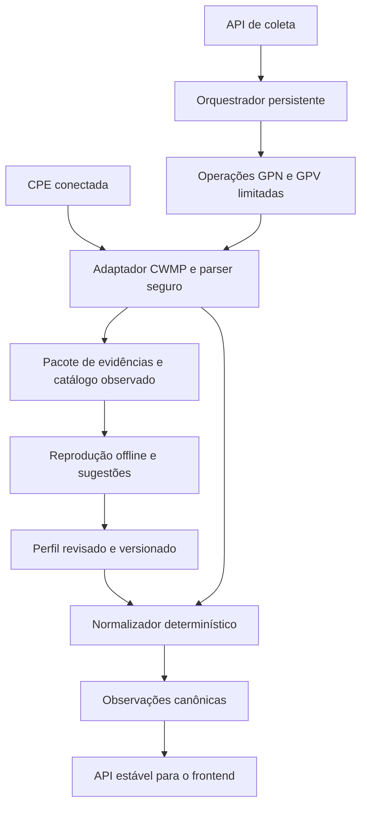

# Arquitetura de compatibilidade de CPEs baseada em evidências

Estado: desenho de referência para evolução incremental; o coletor persistente,
o registro declarativo de perfis e o reprocessamento offline abaixo ainda não estão
implementados. As partes existentes e as próximas entregas estão discriminadas
no fim deste documento. Esta decisão complementa o plano de normalização e
substitui a dependência operacional de acompanhar consultas manualmente.

## 1. Objetivo

Conectar uma CPE ao ACS, iniciar uma coleta controlada e obter um pacote de
evidências que permita desenvolver e testar seu perfil depois, sem conexão com
o equipamento. A bancada será necessária na coleta e na validação final.
O frontend consumirá o mesmo contrato canônico para Huawei, ZTE, TP-Link e outros
fabricantes, sem interpretar caminhos CWMP ou fórmulas proprietárias.

A implementação segue o monólito modular existente: portas e adaptadores,
operações assíncronas auditáveis e domínio independente de infraestrutura.
Não se introduzem microserviços ou um motor de execução de código de fabricante.

## 2. Correções dos exemplos de referência

Pelo TR-069/CWMP 1.0, `ParameterPath=""` representa o topo da hierarquia; `"."`
não é o equivalente normativo. `NextLevel=false` solicita os descendentes;
`true` limita a descoberta ao próximo nível. GPN retorna `Name` e `Writable`;
tipo e unidade não vêm nessa resposta. GPV fornece valores e tipos XML; unidades
precisam de especificação do parâmetro ou evidência revisada.
Fonte: [TR-069, A.3.2.2 e A.3.2.3](https://www.broadband-forum.org/pdfs/tr-069-1-0-0.pdf).

Decisões do projeto: percorrer subárvores autorizadas com GPN por níveis e consultar
valores em lotes explícitos. Não usar uma varredura recursiva integral como padrão.
GPN não oferece paginação convencional; se uma resposta ultrapassar os limites,
a coleta registra a limitação sem afirmar que o catálogo está completo.

Caminhos Huawei/ZTE/TR-181 e a divisão por 1000 presentes em exemplos externos
são hipóteses. Não constituem evidência de suporte ou escala para nossos firmwares.
Não há conversão óptica universal por fabricante. Também não há equivalência
universal entre ProductClass e nome comercial do modelo.

## 3. Componentes e responsabilidades



| Componente | Responsabilidade | Limite |
| --- | --- | --- |
| Parser SOAP/XML | Validar envelope, namespaces, tipos e limites; extrair mensagens | Não decide que um parâmetro significa potência ou WAN |
| Coletor | Registrar evidências de uma execução delimitada e seu progresso | Não publica perfis automaticamente |
| Catálogo observado | Guardar objetos, instâncias, nomes e Writable por dispositivo/coleta | Não declara suporte universal do modelo |
| Resolvedor de instâncias | Selecionar interfaces por critérios do perfil | Não presume que `.1` seja a Internet |
| Registro de perfis | Selecionar revisão aplicável e regras de interpretação | Não aceita código arbitrário vindo do banco |
| Normalizador | Aplicar conversões e validar observações | Não realiza I/O nem envia RPCs |
| Reprodutor offline | Executar parser e normalização sobre evidências armazenadas | Não acessa CPE, rede ou banco operacional |
| API de inventário | Expor valores, unidades, origem e estado | Não expõe caminhos como regra de negócio do frontend |

Caminhos concretos continuam necessários, mas ficam nos perfis/adaptadores de
compatibilidade. O núcleo solicita conceitos como `wan.ipv4` e `optical.rx_power`.
Essas chaves de mapeamento apontam para os campos existentes do contrato
`/telemetry`; não exigem renomear a API ou duplicar sua representação.

## 4. Persistência em quatro grupos

Uma tabela canônica e outra de aliases não cobrem todo o processo. A separação
lógica proposta é:

| Grupo | Dados | Persistência proposta |
| --- | --- | --- |
| Coleta | CPE, solicitante, plano, limites, prazo, estado, cursor e operações | PostgreSQL: `collection_jobs` e `collection_steps` |
| Evidência | Mensagens, catálogo, correlação, hashes, identidade e anonimização | Metadados no PostgreSQL; XMLs/pacotes em armazenamento privado |
| Perfil | Documento imutável, versão, checksum, evidências e estado de homologação | Arquivos JSON versionados no Git; registro de revisões no PostgreSQL |
| Estado canônico | Valor validado, unidade, interface, procedência e última observação | Reaproveitar inventário e `cpe_telemetry_fields` |

Os nomes de novas tabelas são propostos, não migrations já aplicadas.
O catálogo é um snapshot por CPE, firmware e coleta, incluindo instâncias concretas.
A ausência de um nome em uma coleta parcial não prova ausência de suporte.
Dados de diferentes exemplares podem embasar um perfil, preservando suas origens.

## 5. Coleta independente de perfil homologado

O operador seleciona uma CPE já registrada e um plano de investigação. Um perfil
pronto não é pré-requisito: o plano de investigação autoriza subárvores e leituras
para homologação. Essa política é distinta da coleta operacional por perfil ativo.
A CPE permanece autenticada, inclusive em bancada com credencial compartilhada.

Fluxo proposto:

1. Criar uma execução idempotente via API, sem reiniciar o receptor.
2. Aguardar a próxima sessão iniciada pela CPE e registrar sua identificação.
3. Executar GPN por níveis nas raízes permitidas, persistindo catálogo e cursor.
4. Ler em GPV apenas nomes explicitamente autorizados no plano. Descobrir um nome
   não autoriza automaticamente consultar seu valor.
5. Registrar requisições, respostas, faults e cobertura da coleta, vinculados às
   operações existentes. A falha de uma etapa não será mascarada como sucesso total.
6. Finalizar o pacote, disponibilizar progresso e exportação para desenvolvimento.

Planos podem ter uma primeira fase de descoberta sem valores. Os candidatos são
revisados offline; uma segunda coleta limitada obtém amostras autorizadas. Quando
um plano já contém leituras revisadas, ambas as fases podem avançar automaticamente.
Um equipamento desconhecido não requer uma captura irrestrita de todos os valores.

A execução retoma pelo cursor após reinício do processo, sem duplicar etapas
concluídas. Aproveita a fila atual: uma operação ativa por CPE e uma por sessão.
O coordenador deve respeitar conflitos com consultas manuais e não criar uma fila
paralela que ignore esses limites. Estados propostos: `queued`, `running`,
`completed`, `partial`, `failed`, `expired`, `cancelled`. Cancelar interrompe novos
despachos; não desfaz um RPC já enviado.

Cada plano limita tempo total, quantidade de RPCs, bytes, objetos, profundidade,
nomes por resposta e parâmetros por GPV. Limites excedidos deixam evidência de
coleta parcial. Não aumentar limites XML silenciosamente para acomodar uma CPE.
Uma sessão inválida ou expirada não é reutilizada para continuar a investigação.

A disponibilidade deixa de depender da presença do desenvolvedor. Ainda depende
de a CPE se comunicar durante a janela de coleta. Não requer reboot, alteração da
WAN ou implementação de Connection Request.

## 6. Pacote de evidências

Formato proposto, versionado e portátil:

```text
capture-UUID/
  manifest.json
  device.json
  catalog.json
  messages/
    0001-inform.xml
    0002-get-parameter-names-request.xml
    0003-get-parameter-names-response.xml
    0004-get-parameter-values-request.xml
    0005-get-parameter-values-response.xml
  expected/
    telemetry.json
```

`manifest.json` registra versão do formato, identidade técnica, firmware/hardware
quando observados, horário do ACS, sessão/RPC/operação correlacionados, tamanho e
SHA-256 de cada artefato, plano/limites, resultados e caminhos não investigados.
Também identifica anonimizações, substituições de tipos e perdas de fidelidade.
`expected/` é produzido na revisão do perfil, não considerado verdade só porque
foi gerado pelo mesmo código que será testado.

O artefato original e a fixture anonimizada são distintos. A captura original,
quando habilitada na execução autorizada, fica em armazenamento privado com
controle de acesso, retenção definida e criptografia para armazenamento compartilhado.
Não guardar cabeçalhos Authorization, cookies ou chaves TLS. Não publicar XML bruto
em logs ou Git. Exportação comum entrega a versão anonimizada revisada.

Preservar namespaces e tipos sempre que possível; substituir identidades, IPs,
MACs e identificadores por valores sintéticos consistentes entre as mensagens.
Documentar cada transformação. Uma projeção que reteve apenas DeviceInfo não pode
ser apresentada como envelope original ou catálogo completo.

Limites de tamanho, autenticação, autorização e parsing seguro precedem a publicação
de mensagens recebidas. Corpos inválidos não são arquivados por padrão. Uma falha de
armazenamento deve tornar a evidência incompleta, sem derrubar o fluxo de Inform.
Publicação atômica, hashes e reconciliação de referências entre PostgreSQL e arquivos
são requisitos; não prometer atomicidade entre disco e banco sem implementá-la.

## 7. Perfis declarativos, versionados e testáveis

Adotar JSON na primeira versão, sem dependência nova para YAML. Validar o documento
na borda com schema fechado e convertê-lo para dataclasses no domínio.
Manter os arquivos como fonte de verdade; o banco registra revisões importadas e
qual revisão está ativa. Uma interface futura deve gerar nova revisão, sem editar
silenciosamente uma regra que já produziu observações.

Cada perfil define:

- Identificação: ID, versão do formato, revisão e checksum.
- Aplicabilidade: fabricante/OUI, ProductClass, evidência de modelo, firmware,
  hardware quando necessário, versão CWMP e raiz do modelo de dados.
- Coleções: objetos de origem, variáveis de instância e critérios de seleção.
- Mapeamentos: chave canônica, caminho ou template, tipos XML aceitos, unidade de
  origem, conversão identificada e unidade canônica.
- Validação: intervalos, cardinalidade, estados vazios, conflitos e alternativas
  explicitamente ordenadas.
- Evidência: IDs/hashes de pacotes e casos esperados que sustentam cada regra.

Exemplo conceitual de regra, deliberadamente sem caminho Huawei presumido:

```json
{
  "canonical_field": "optical.rx_power",
  "source_path": "CAMINHO_CONFIRMADO_NA_COLETA",
  "accepted_xml_types": ["xsd:int"],
  "conversion": {
    "id": "scaled_decimal_v1",
    "numerator": "1",
    "denominator": "1000"
  },
  "output_unit": "dBm",
  "evidence_refs": ["PACOTE_COM_ESCALA_CONFIRMADA"]
}
```

O fator acima é apenas ilustrativo. Para uso real, deve haver comprovação específica
da unidade e escala. Conversores pertencem a um registro fechado de funções puras,
com versões estáveis: endereço IP, lista de DNS, MAC, enum e conversão decimal, por
exemplo. Não usar `eval`, Python, SQL ou expressões executáveis armazenadas em perfis.
Conversões não lineares exigem conversor próprio testado; não aproximar tudo por um
fator multiplicativo. Valor sem unidade confirmada permanece `unverified`.

Perfis não devem incorporar números de instância observados em uma única CPE.
Templates como `WANDevice.{wan}.WANConnectionDevice.{connection}.WANPPPConnection.{ppp}.`
são resolvidos contra o catálogo da CPE. Critérios determinam Internet/PPPoE,
TR-069 ou outras finalidades, preservando múltiplas interfaces. Reutilização de
números após reconfiguração exige nova descoberta e observações recentes.

Seleção: regras específicas revisadas precedem regras genéricas documentadas.
Perfis igualmente elegíveis sem desempate explícito geram conflito, sem escolher
pela ordem de cadastro. Firmware novo pode continuar no inventário genérico, mas
não herda automaticamente consultas e conversões proprietárias do firmware antigo.
Cada operação congela revisão, checksum, instâncias e nomes solicitados; reprodução
usa a mesma revisão e a mesma versão de conversor.

Ciclo proposto: `draft` → `validated_offline` → `validated_on_device` → `active` →
`deprecated`. A validação considera capacidades/campos, não homologa um equipamento
inteiro por um único parâmetro. Novas revisões não recalculam silenciosamente dados
históricos. Reprocessamentos são explícitos e preservam a origem anterior.

## 8. Sugestões automáticas e contrato canônico

Palavras como RxPower, Optical e DNS podem sugerir candidatos no catálogo já
parseado. Regex pode filtrar caminhos; não deve analisar a estrutura XML.
A sugestão guarda justificativa, evidência e estado de revisão. Ela não ativa um
mapeamento, não define unidade e não autoriza leitura automaticamente.

O contrato público mantém valores por interface com origem, horário e perfil.
`null` não é substituído por zero. Último valor válido permanece separado da última
observação, inclusive inválida ou vazia. Valores sem equivalência canônica podem
entrar em extensões com schema próprio revisado; não criar um dicionário público de
parâmetros arbitrários. Compatibilidade não deve impor mudanças de schema REST para
cada novo fabricante.

## 9. Organização no backend

Localizações propostas, aproveitando os módulos existentes:

| Local | Papel |
| --- | --- |
| `acs.domain.cpe` | Campos canônicos, observações e metadados |
| `acs.domain.operations` | Estado de coleta, etapas, evidência e contratos de perfil |
| `acs.application.services` | Criar/acompanhar coleta, resolver plano, importar e reproduzir evidências |
| `acs.cwmp.soap` | Parser/serializer seguro e preservação de informações do protocolo |
| `acs.cwmp.compatibility` | Carregamento de perfis, seleção, conversores e regras específicas |
| `acs.infrastructure.database` | Jobs, etapas, catálogo, revisões e vínculo com operações |
| `acs.infrastructure.storage` | Artefatos privados, exportação anonimizada e retenção |
| `acs.api` | Schemas Pydantic, autorização e endpoints de coleta |
| `tests/fixtures/cwmp` | Pacotes revisados com origem e resultados esperados |

Rotas propostas, ainda não disponíveis:

- `POST /api/v1/cpes/{cpe_id}/collections`: iniciar execução e retornar 202/ID.
- `GET /api/v1/cpes/{cpe_id}/collections/{id}`: consultar progresso e cobertura.
- `POST /api/v1/cpes/{cpe_id}/collections/{id}/cancel`: impedir novas etapas.
- `GET /api/v1/cpes/{cpe_id}/collections/{id}/export`: exportar pacote anonimizado.

Permissões próprias de coleta/exportação devem ser definidas na implementação;
a opção de inventário anônimo não concede acesso a evidências. FastAPI permanece
um adaptador: nenhum fluxo de coleta ou regra de fabricante dentro da rota.

## 10. Entregas e critérios de aceite

A base atual possui sessões, autenticação, fila GPN/GPV, normalização básica,
telemetria em desenvolvimento e captura parcial de Inform. Ainda há regras de
compatibilidade em Python, coleta manual e ausência de execução persistente de
um plano de investigação. A escala óptica real permanece sem confirmação no código.

1. **Coletor persistente e pacote:** execução pela API, vínculo com a fila existente,
   progresso, retomada, limites e exportação anonimizada. Deve funcionar sem perfil
   operacional pronto e sem reiniciar receptor ou equipamento.
2. **Perfis e reprodução offline:** schema JSON, catálogo de revisões, conversores,
   resolução de instâncias e comando de replay sem rede. Migrar regras existentes
   gradualmente, mantendo os contratos e as fixtures já revisadas.
3. **Homologação WAN/óptica:** obter pacote da X6-10 disponível em bancada, comparar
   Rx/Tx com referência independente, testar IPv4/IPv6/MAC/DNS e ativar apenas
   os mapeamentos confirmados. A V5-V2 continua com evidência própria, sem herdar
   automaticamente a homologação da X6.
4. **Expansão:** acrescentar modelos por novos pacotes/perfis e testes de regressão;
   agendamento periódico e interface de gerenciamento ficam para entrega posterior.

Testes obrigatórios por entrega relevante: autorização e isolamento de CPE; esquema
fechado de perfil; XML/XXE/tipos; limites e catálogo parcial; duplicatas e retomada;
concorrência com consultas manuais; falha de disco/banco; exportação sem segredos;
mesmo pacote produzindo mesmo resultado offline; ausência de rede no replay;
conflitos de seleção; diferentes instâncias/interfaces; unidades e sentinelas;
preservação do último valor válido; migrations PostgreSQL; contrato OpenAPI.
Cada perfil novo deve reutilizar uma suíte comum de conformidade, adicionando
fixtures e expectativas específicas. Uma fixture gerada por hipótese é sintética,
não evidência de homologação. A validação final real confirma o ciclo CWMP completo.

Esta etapa não acrescenta RPCs de escrita, reboot, firmware ou Connection Request.
Os faults continuam sujeitos à versão CWMP adotada; estados internos de coleta não
são códigos SOAP.
